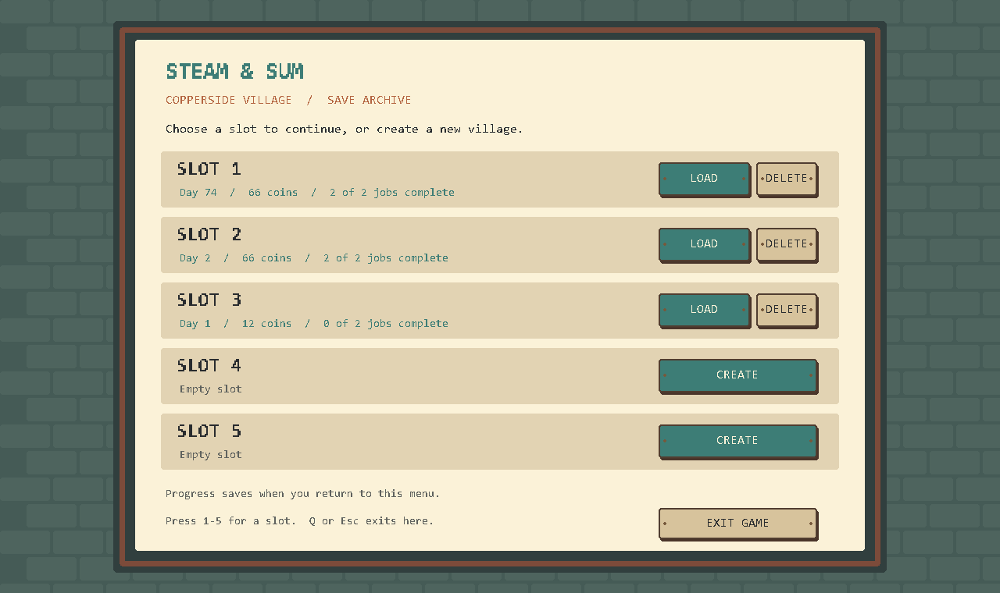
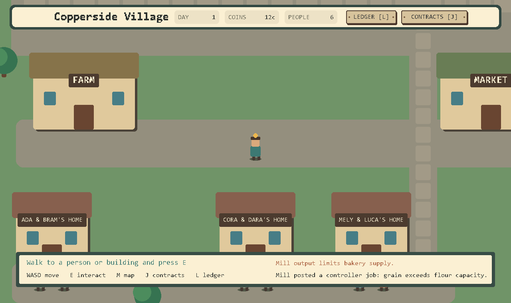
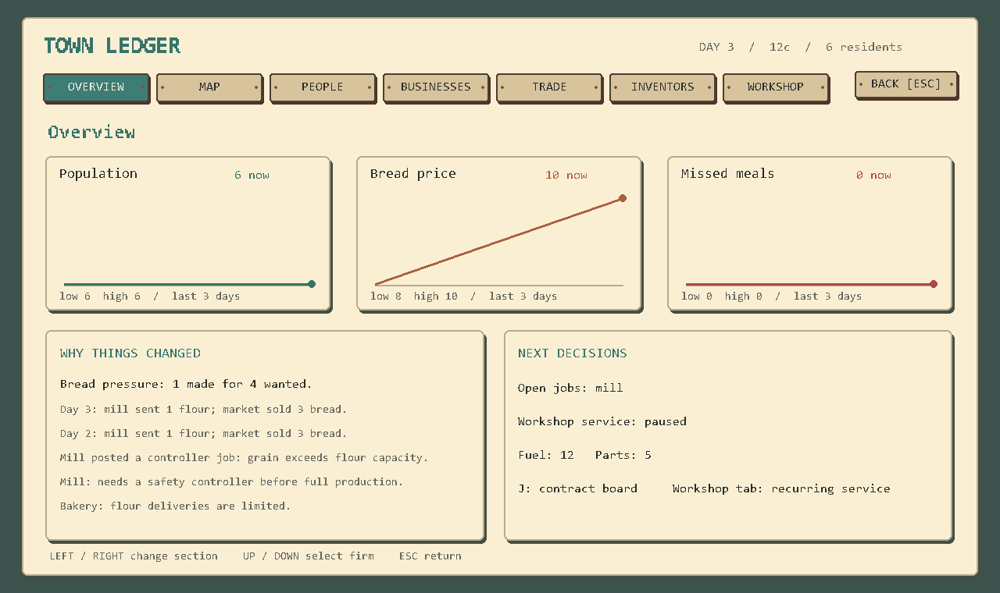
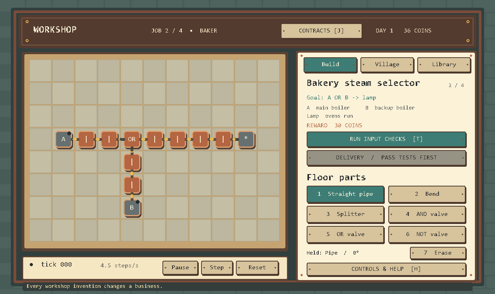
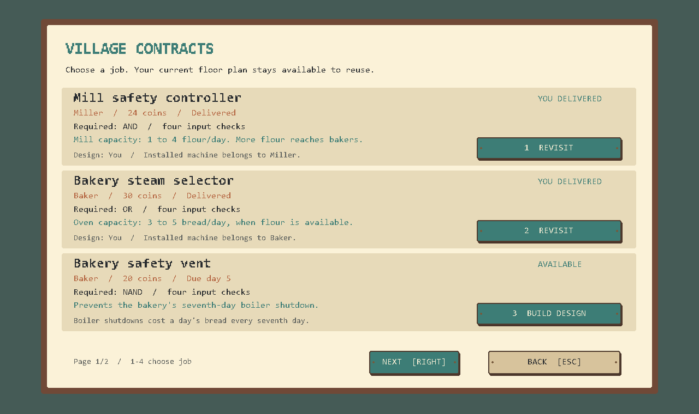
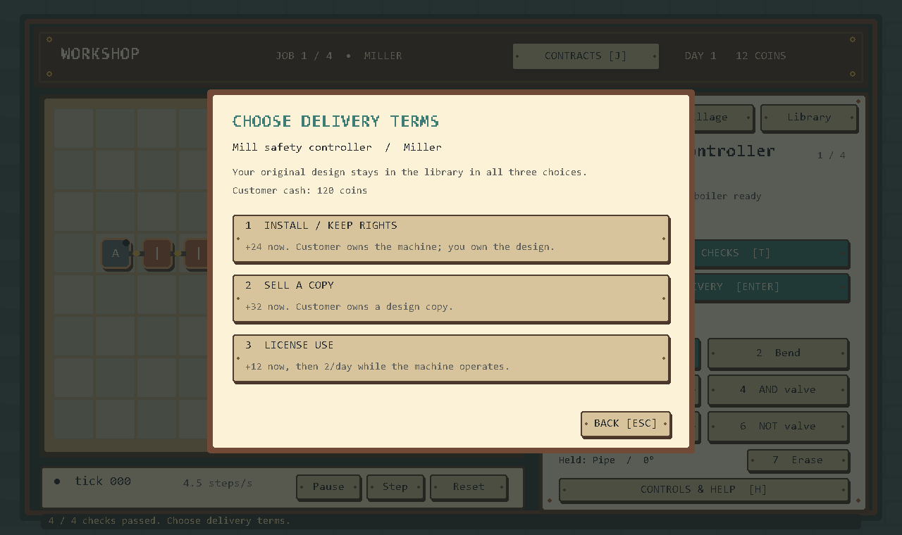
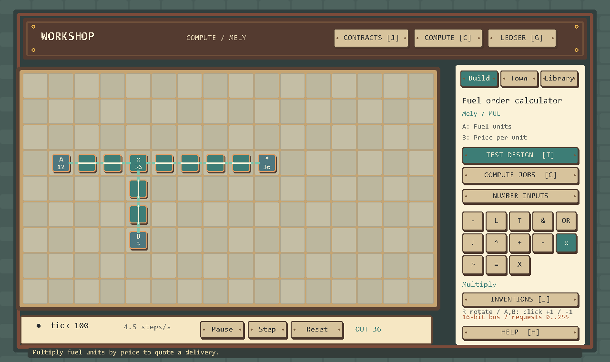
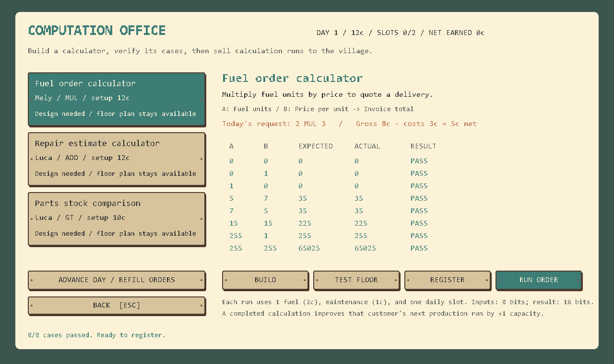

# Numbermill

A playable slice of a top-down steam computation game. Walk around a compact village, meet its residents and inventors, build machines on the workshop floor, and watch their work change local production and trade.

See [ROADMAP.md](ROADMAP.md) for the planned business market, rival inventors, computation services, migration, village growth, regional trade, and eventual generated jobs.










## Run on Windows

This workspace already has a local virtual environment with Pygame installed. From this folder, run:

```powershell
.\.venv\Scripts\python.exe game.py
```

### Run from VS Code

Open this project folder in VS Code, select **Numbermill** in the Run and Debug view, and press **F5**. The included `.vscode/launch.json` uses this project's `.venv`, so the game opens in its own window and logs appear in VS Code's integrated terminal. The Python and Python Debugger extensions are recommended; both are already installed on this computer.

To set up the project elsewhere, install Python 3.10 or newer, then run:

```powershell
py -m venv .venv
.\.venv\Scripts\python -m pip install -r requirements.txt
.\.venv\Scripts\python game.py
```

If `py` is unavailable, use your Python installation's full path in those commands.

## Controls

Press **J** in town or the workshop, or click **Contracts**, to open the job board. It shows rewards, business benefits, posting reasons, due days, rival bids, and design ownership. Use **Next** or the right arrow to see the fourth job. Select **Build Design** (or `1`–`4`) to work on a job using your current floor plan. **Esc** returns to the previous screen. The mill posts first; the bakery selector follows when mill capacity makes improved ovens worthwhile. The bakery safety vent and market cooler appear after that. An offer is due four days after posting. After three days, Nell bids on an open job and delivers two days later. You can still deliver while Nell is building. If the deadline passes, the business visibly waits for Nell or renews its offer. If the customer cannot afford Nell, expansion is postponed without putting the firm in debt.

The game opens at a five-slot save menu. Click **Load** or **Create**, or press `1`–`5` for a slot. Your existing `save.json` and `designs.json` appear together as **Existing save** in slot 1. Loading it and returning to the menu writes the new slot file while leaving the originals untouched. Empty slots create fresh villages. Existing saves gain newly added businesses when loaded.

Click **Delete** beside a save, then confirm to empty that slot. Cancel or press **Esc** to keep it. Deleting slot 1 hides the old pre-slot save from the menu so it does not reappear; the original `save.json` and `designs.json` remain on disk as a manual backup. Other slot files are removed after confirmation.

In town, use **WASD** or the arrow keys to walk and **E** to talk or enter the workshop. **Esc** closes a conversation or returns to the save menu. In the workshop, **Esc** returns to town. **Q** returns to the save menu from either scene and saves your progress. Choose **Exit Game** there to quit; `Q` or `Esc` also exits from the menu.

The village has short east/west and north/south streets. Press **M** for its map, **L** for the Town Ledger, and **J** for contracts. The ledger has Overview, Map, People, Businesses, Trade, Inventors, and Workshop sections. Use left/right to switch sections; up/down selects a person or firm, or moves through trade days. The workshop also opens the ledger with **G**. Talk to a resident and press **1**, **2**, or **3** for work, family, or town topics.

| Action | Control |
| --- | --- |
| Select straight pipe, bend, splitter, AND, OR, NOT | `1`–`6` or click a part |
| Select eraser | `7` or `Delete` |
| Place selected part | Left click an empty floor tile |
| Toggle A or B | Left click its fixed blue block |
| Rotate held part | `R` |
| Rotate placed part | Right click it |
| Pause / run | `Space` |
| Advance one simulation step | `.` |
| Change speed | `+` / `-` |
| Test the current commission | `T` |
| Choose delivery terms for a tested design | `Enter` or the Delivery button |
| Save a reusable design copy | `S` |
| Open Build / Village / Library tabs | `B` / `V` / `L` |
| Open Town Ledger from workshop | `G` |
| Open computation jobs and paid orders | `C` or **Compute** |
| Open binary invention challenges | `I`, **Inventions**, or a locked arithmetic symbol |
| Number inputs: increase / decrease A or B | Left / right click its block; hold `Shift` for steps of 16 |
| Save and return to menu | `Q` |
| Open workshop controls and help | `H` or click **Controls & Help** |

Signals advance one component per simulation step. Straight pipes, bends, and splitters carry steam in either direction through connected ends; valves still have defined inputs and outputs. The drawn steam follows the current state; pipe length itself adds no special penalty. Fixed blocks A and B supply signals; the lamp is the output. The starter commission requires an AND valve. B points north, so rotate straight pipes once to carry its steam upward. Tests reset the machine for each input combination and require the output to settle correctly.

Run the four input checks, inspect the pass/fail table, then choose **Install / Keep Rights**, **Sell a Copy**, or **License Use**. Installation pays the listed reward and leaves design rights with you. Selling a copy pays a larger amount up front; the customer owns that copy and you retain the original. Licensing pays half the reward up front and 2 coins on each paid day. The machine pauses on days when the customer cannot pay. Each approved design is saved in the library with its owner and customer rights. Editing the floor after a successful test requires another test before delivery. **AND** means both inputs must be on; **OR** means either input can be on; **NAND** is AND followed by NOT; **NOR** is OR followed by NOT. The four jobs use these rules in order.

Each save slot is stored in `saves/slot_N.json` and contains village progress, the current floor layout, town position, ownership and licenses, trade and chart history, and that slot's design library. Older town positions migrate to the new map. Progress also saves when you complete a commission, save a design copy, or advance a day. Loading a library design creates an editable copy. The mill increases flour production; the bakery selector increases bread capacity; the safety vent prevents a seventh-day bakery shutdown; the market cooler prevents one loaf of spoilage every sixth day. Open the Village tab in the workshop to advance a day and see prices and deliveries change.

The economy has separate farm, mill, bakery, market, fuel yard, and repair shop firms. Six residents live in three households. Mely owns the fuel yard, Luca owns the repair shop, and they share a home. Luca buys fuel from Mely to produce parts and sells some parts to a passing mechanic from day 7; businesses also buy Mely's fuel to run installed steam machines. A machine pauses on a day its firm cannot obtain fuel. Residents have persistent needs and memories, choose activities after each day, and walk to their destinations. Talk to them or open People to understand what they are doing. The Inventors section shows Nell's current bid and past deliveries.

At the market, **E** opens shopping; press **E** again to buy one loaf into your saved pantry. **N** advances a day for another delivery, and **Esc** closes shopping. Household shoppers leave one loaf on the counter when stock allows, so the player has a chance to buy. Bread currently stays in your pantry; eating and player hunger are not implemented yet.

After delivering a design, open **Ledger > Workshop** to offer recurring service. Each fulfilled order buys one fuel from Mely and one part from Luca for five coins total. A funded customer pays seven coins and gains one capacity for that day, leaving two coins of net income. An order pauses for the day when supplies or customer funds are insufficient. This service is an early foundation; future computation jobs will add more uses for saved designs and richer customer decisions.

## Reusable devices

In the workshop, open **Library** and use **Name ports** to label A, B, and the output. Save the floor, then choose **Place device** beside any saved design. Place it on the grid like a valve; **R** rotates the held device. Its first input is west, its second input is south, and its output is east before rotation. Hover a placed device to see its names and pin directions. Devices can contain other devices and use the same delayed steam simulation as the surrounding circuit.

**Right-click a device** to inspect a simulation copy of its interior. Right-click another device inside it to look deeper; **Esc** or **Back to parent** returns one level. To change a device, **Load / edit** its saved design from Library and **Save new version**. Existing placements keep the complete version they were built with. Select the new version explicitly to use an updated design. Old floor plans remain loadable and can also be placed as devices. Devices now carry two 16-bit input buses and one output bus; larger configurable port layouts remain future work.

In town, **click any visible NPC** to inspect them without walking over. Click another NPC to switch or press **Esc** to close. Residents now spend time at their destination and choose another activity while you explore. Work, rest, social needs, and household funds influence those choices. Meals, wages, and purchases still resolve when advancing an economic day.

## Arithmetic workbench and computation income

New villages start with **ADD, SUB, GT, EQ, and MUL locked**. Earn each standardized block once in **Inventions [I]** by constructing a small binary prototype from AND, OR, XOR, and NOT gates. Locked palette symbols show a padlock and open the corresponding lesson. XOR is a free primitive gate, shown as `^` in the normal workshop.

| Prototype | Gate budget | Binary cases | Permanent unlock |
| --- | --- | --- | --- |
| Half-adder: sum and carry | 2 | 4 | ADD |
| One-bit difference and borrow | 3 | 4 | SUB; requires ADD first |
| One-bit greater-than and equality | 4 | 4 | GT and EQ |
| Two-row, 2 by 2-bit multiplication | 8 | 16 | MUL; requires ADD first |

Choose a gate, then click a slot to place it. Click an input or gate's output dot to select a source, then click a gate input socket or fixed output terminal to connect it. Input terminals toggle 0/1. **Step [.]** moves signals one gate layer at a time; active wires turn green. **Test all [T]** checks every input combination and shows expected and actual output bits. Click any result row to trace those inputs. Right-click a gate to remove it, or a socket to disconnect it. The fixed terminals, small gate budgets, and binary-only parts keep lessons compact; there is no 16-bit wiring requirement.

Passing a lesson immediately saves its permanent unlock and a copy of the successful prototype. Drafts also save when leaving the bench or returning to the menu. Editing a completed prototype cannot remove its unlock. The earned industrial blocks use the existing 16-bit decimal signals in normal designs and nested devices. Locked arithmetic cannot be placed indirectly through saved designs or nested devices, or registered as a computation service. Existing saves from before this progression retain only the arithmetic technologies already present in their floor, library, or registered calculators; unused arithmetic stays locked.

The Build tab uses a compact symbol palette beside a **16 by 9 grid**, giving 144 cells instead of 88. Hover a symbol to see its name. The existing input and output anchors stay in place so older designs still work. Library and interior inspection show the whole grid at a smaller scale. **Number inputs** lets A and B cycle through 0–255; left click increases, right click decreases, and Shift changes by 16. Values appear inside numeric blocks and beside the simulation controls.

| Symbol | Block | Result |
| --- | --- | --- |
| `+` | Add | A + B |
| `-` in the arithmetic row | Subtract | A - B, stopping at zero |
| `x` | Multiply | A times B |
| `>` | Greater than | 1 if A > B, otherwise 0 |
| `=` | Equal | 1 if A equals B, otherwise 0 |

Signals use unsigned 16-bit buses (0–65535). Addition and multiplication wrap above 65535. Boolean gates still treat nonzero signals as on and output 0 or 1. Joined pipe sources combine with bitwise OR, so use gates to combine separate operands deliberately. Devices preserve numeric values and internal delays.

Open **Compute [C]** in town or the workshop, or use **Ledger > Workshop > Computation Office**. Mely requests fuel invoices (multiply); Luca requests repair estimates (add) and stock checks (greater than). Choose **Build**, create the calculator, and use **Test design**. The office checks eight cases, including zero, unequal operands, and 255 boundaries. **Register** pins a tested copy for service and pays a customer-funded setup fee once. Re-registering updates the copy without paying another setup fee.

**Run order** evaluates the registered circuit against the customer's current request, then pays only for a correct, settled result. Each run uses one fuel bought from Mely for 2c, consumes 1c in workshop maintenance, and occupies one of two daily calculation slots. Mely and Luca pay 8c per quote (5c net); stock comparisons pay 7c (4c net). Each calculator has at most one order per day. Shortages, insufficient customer money, or insufficient upfront funds leave resources unchanged. Advance a day for new requests and capacity. Completed planning gives the customer +1 production capacity for the next production run; it does not stack within a day. Calculation designs, revisions, receipts, earnings, and the active job are saved.

Test screenshots and their machine-readable report are in `testing-screenshots/`. Regenerate them in a fresh test village, without writing player saves:

```powershell
.\.venv\Scripts\python.exe scripts\capture_feature_checks.py
```

## Check the rules

```powershell
.\.venv\Scripts\python.exe -m unittest discover -s tests -v
```

The four commissions are hand-authored and stored in `commissions.py`. A future local LLM could propose a job's story, inputs, expected outputs, reward, and economic effect. Before offering it, the game should validate the truth table, check that the available parts can solve it, and bound its effect on the village. The current game runs without an LLM.
