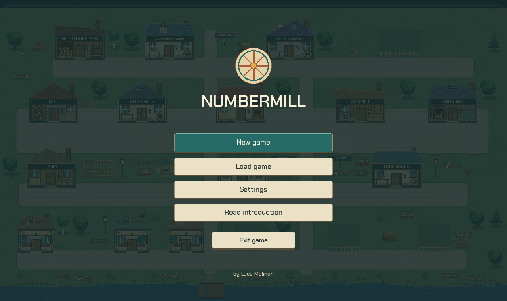
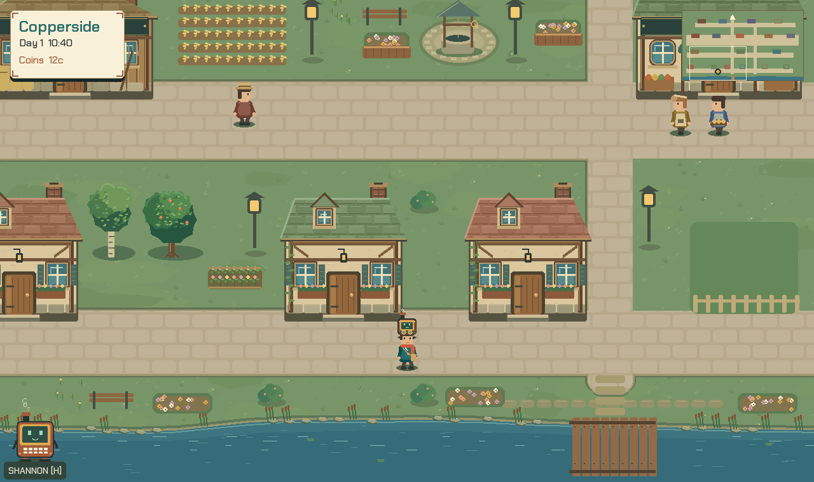
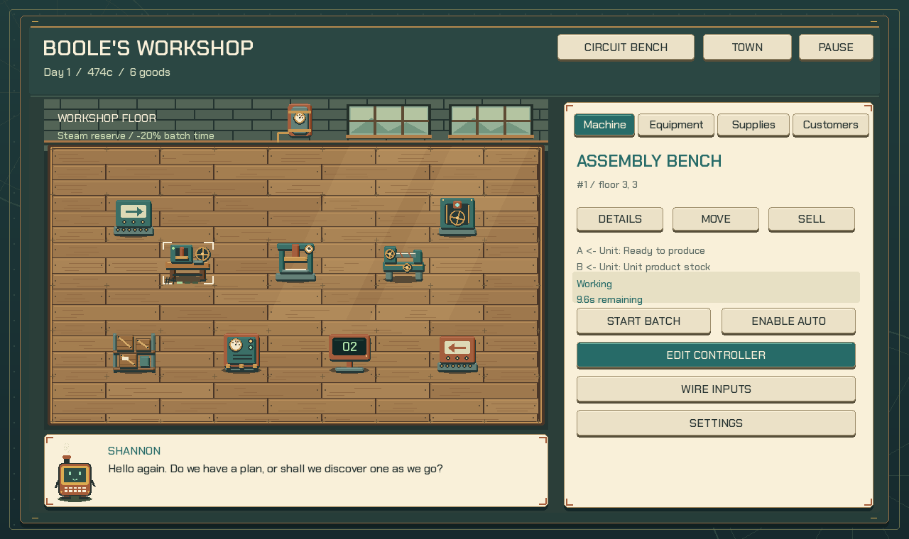
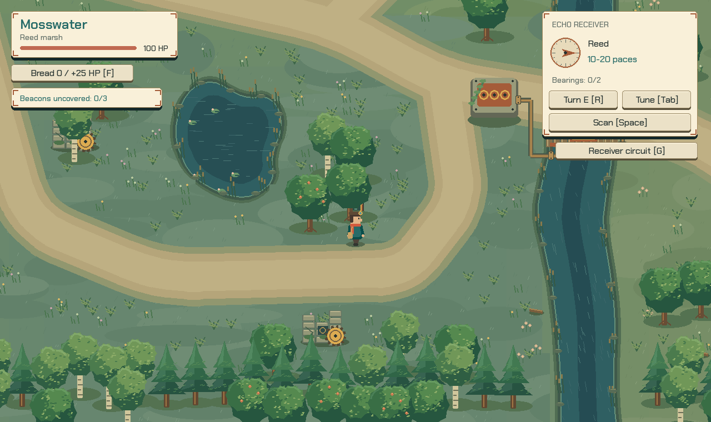
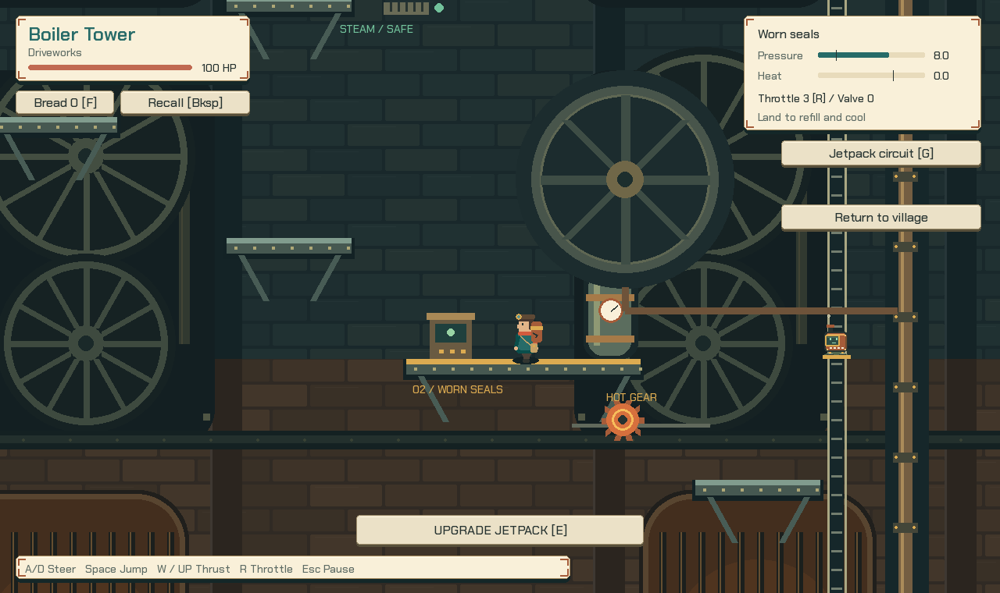

# Numbermill

A village engineering game about building a livelihood with Shannon, your steam-computer companion. Arrange a physical manufacturing workshop, buy local materials, make goods, and automate machines with circuits. Explore Mosswater from above, then climb Boiler Tower with a player-controlled steam jetpack in side view. Village commissions, inventions, and computing services remain available as side activities.

See [ROADMAP.md](ROADMAP.md) for current manufacturing progress and the planned exploration, gadgets, technology discoveries, and hackable hazards.







## Display and presentation

The window supports resizing and maximizing. **F11** switches borderless fullscreen; the game keeps its proportions and maps clicks through the scaled view. **Settings**, available from the title and pause menus, offers smooth scaling, reduced motion and a controls reference. Pixel edges stay crisp with smooth scaling off. Reduced motion calms decorative animation while gameplay hazards and their warnings remain active. Preferences save separately from player slots.

Fullscreen uses the current monitor's native resolution and exact bounds, including monitors left of the primary display. Windows DPI awareness prevents an additional blurry operating-system stretch. With **Smooth scaling Off**, fullscreen uses whole-pixel enlargement and centered borders for sharper text/art; **On** enlarges the view to fit the available screen. The underlying game canvas remains 1280 × 760. Restart after updating so DPI awareness takes effect.

**Continue** resumes the last valid slot; **New game** chooses an empty slot. **Esc** closes the current panel first, then pauses; the factory pause menu includes **Back to town**. Switching away from the game pauses active play. Tab/Shift+Tab or arrow keys move focus in title, save, pause and settings menus; Enter/Space activates the focused button.

The October 25 art pass refreshes Copperside architecture, cottage roofs, gardens and work yards; Mosswater woodland/marsh/ruins; the tower's furnace, gearworks and mountain-window sections; workshop machines, circuit surfaces, portraits and supporting menus. All ponds and rivers use natural outlines shared with collision. Old saves affected by changed shorelines recover onto nearby dry ground.

See [VISUAL_STYLE.md](VISUAL_STYLE.md) for the scene inventory and reproducible capture commands. `scripts/capture_presentation.py --play` opens a disposable preview; `--smoke` checks real resize/fullscreen presentation and closes automatically. These previews use isolated saves and preferences. Audio, fuller character expressions, connected homecoming scenes and the new regions remain planned.

## Start manufacturing

Enter your workshop with **E** to open the production floor. The **Circuit Bench** button keeps the existing circuit editor, commissions, invention goals, and computation services available.

1. Open **Equipment**, choose the first **Assembly bench (4c)**, and click an empty floor tile. This is a one-time refurbished unit from Tess; additional benches cost 24c.
2. Open **Supplies** and buy **one metal (2c), one fitting (3c), and one fuel (3c)**. Purchases transfer actual shop inventory and pay Otto, Tess, and Mely. The starting 12c covers the bench and one complete batch.
3. Select the bench and choose **Start One Batch**. It consumes those inputs once and produces a repair kit in 12 seconds of village time.
4. Open **Customers** and sell a kit for **10c** to an available buyer. Local trades buy when they have funds and stock-room for productive maintenance. Their kit grants +2 capacity for six days on which they actually produce. The Road Crew Mechanic, on the second customer page, has one externally funded order per day and uses the delivered kit next morning. Orders and payments cannot repeat through reloads.
5. Reinvest profits in equipment. A controller cabinet costs 6c, a storage rack 6c, a production display 4c, and procurement/dispatch units 8c each. New equipment uses fittings from Tess's stock. Click an icon in **Equipment** or **Supplies** for details and purchasing. Placement is paid only when a valid empty tile is clicked; **Move** rearranges existing equipment. **Esc/right-click** cancels placement.

Base finished-goods storage holds six products in total; each rack adds six. Machines reserve output space when consuming supplies, so simultaneous batches cannot overflow storage; refinement accounts for the intermediate products it consumes. Racks expose the shared workshop inventory, rather than separate inventories per rack. Select equipment and choose **Sell** to review a resale quote: Tess pays half its recorded purchase price, rounded down, if she has the cash. Working machines and storage needed for existing/reserved products cannot be sold. Selling a cabinet stops its unit's automation; selling a connected rack stops affected units and leaves those inputs reading zero until rewired. Reconnect before enabling Auto again.

Select a production display and choose **Configure Display** to show finished goods, materials, coins, production/sales totals, or a unit's **Controller OUT**. That last source displays the result of your own circuit, including calculated values up to 65535. Shannon remembers first purchases, production, sales, and automated batches, with saved comments that wait until you return to the floor.

## More manufacturing and the first expedition

The **Circuit Bench** button opens your saved sandbox. Escape returns to the production floor. Contracts remain available from their own button.

Select a component and click **INFO** below its description for a diagram labeling each input and output and explaining what signal belongs there. The diagram starts at the selected placement rotation. **Rotate View / R** rotates only the preview; **Escape** closes it. This is available in the bench, factory controller and adventure editors, and simulation pauses while you read.

| Machine | Inputs per batch | Output | Batch time | Sale value |
| --- | --- | --- | --- | --- |
| Assembly bench | 1 metal, 1 fitting, 1 fuel | Repair kit | 12 seconds | 10c |
| Metal press | 2 metal, 1 fuel | Metal plate | 9 seconds | 11c |
| Valve lathe | 1 metal, 2 fittings, 1 fuel | Steam valve | 15 seconds | 16c |
| Precision gear cutter | 1 plate, 1 valve, 1 fuel | Precision gear | 10 seconds | 36c |

The press and lathe are available immediately; the cutter needs the Mosswater blueprint. Each new product has two funded outside orders per day. Storage, displays and dispatch settings expose each product separately. Intermediate goods can be sold or used in the gear cutter.

Follow the **north road** to the **Mosswater sign** and press **E** to leave town. Walk with WASD/arrows and interact with E. Inspect the abandoned receiver to equip Shannon, then build its decoder in the familiar circuit editor. Read **Specification** for exact input/output behavior; **T** tests and installs a passing circuit. The guarded crossing has a separate pressure-and-latch interlock. Both must work over their full operating ranges; constant-output shortcuts fail.

Beyond the first bridge, inspect the **survey station**. Mosswater continues through branching woods and marshes. Use **R** to turn Shannon's receiver, **Tab** to select a beacon channel and **Space** to scan; matching returns show distance bands, while a wrong bearing shows **No return**. Locate Crown, Fern and Reed by recording each from two different bearings at least 18 paces apart, then scan within 10 paces to uncover it. The eastern range-lock station gives the final distance constraints. Its two channel readings must agree at the same location before the archive bridge opens. Existing saves retain circuits and rewards, with new survey progress saved independently.

The artifact unlocks the precision cutter and a receiver lens that improves nearby distance readings from 10-pace bands to 2.5-pace bands. **G** reopens the receiver circuit. **F** uses one owned loaf to restore **25 health**, capped at 100; bread is not consumed at full health. There is no player hunger or passive health drain. Active bridge traps deal **25 damage** and push you back; steam stops when the trap is disabled. At zero health, Shannon returns you to town with 40 health. Return along the path to leave normally. Escape closes dialogs/editors first, then opens pause. Field drafts, installed designs, health and rewards survive saving; existing workshop and sandbox designs stay separate. Older saves discard the retired player hunger value without changing progress.

## The connected opening chapter

Press **B** in Copperside, the production workshop or either expedition to open Boole and Shannon's **Field journal**. Evidence separates observed facts from open questions; **Moments** contains the opening conversation and homecomings unlocked by your discoveries. **Tab** switches sections, **Up/Down** selects an entry, and **Left/Right** changes pages. Reading pauses village time, production and hazards.

After returning home, click the homecoming prompt or press **Enter** to talk. **Esc** leaves the conversation at its saved page; completed moments can be replayed. New conversations wait for Copperside, while remembered moments remain available in the field. Older saves receive the appropriate follow-ups without repeating rewards or changing their circuits.

When speaking with **Shannon, Luca, Mely or Grace**, click **Journey** or press **6** for reactions to the evidence you have actually found. Mely and Luca also reflect existing personal-project progress. A quiet scene by the well becomes available after the Mosswater homecoming and the first completed chapter of either personal arc.

## Second level: Boiler Tower

Finish the expanded Mosswater archive, then click **Travel to Boiler Tower** in Mosswater's field view. On later visits, enter through the village's north trail and use the same button. Older saves with only the original cutter/lens reward must still complete the survey archive to unlock this route.

Climb **31 solid platforms** through the Boiler Galleries, Driveworks and Condenser Crown. Each stretch between maintenance puzzles now contains **ten traversals**, with green-flag rest checkpoints along the way. **A/D or arrows** move, **Space** jumps, **W/up** fires the pack, and **R** changes throttle. At the first brass landing, press **G** and build the flight controller from its specification; **T** certifies and installs it. Every platform refills pressure and cools the pack when thrust is released. Platforms block your head and sides as well as your feet: fly around their edges to climb onto them.

Fifteen moving or timed hazards interrupt the route. Steam nozzles flash amber and mark their plume before bursting; hot gears sweep across the gaps; striped pistons warn before extending. Wait at a platform's safe center, then time your crossing or change your flight height. These hazards remain active independently of the maintenance circuits. Rest flags save progress without opening another puzzle.

Flight carries sideways momentum: hold A/D to accelerate, release to coast, and hold the opposite direction to brake and turn. Walking speed carries into takeoff. Landing stops uncommanded drift, and ground movement stays immediate.

Two maintenance landings introduce worn and cracked seals. Pressure capacity drops from **12 → 8 → 5**, heat cutoffs lower, and thrust weakens. Revise your own previous controller draft at each landing. The specification names the stage and explicitly lists changes to gain, minimum pressure and heat cutoff. The upper deck also requires an exhaust regulator (**V**) to clear its steam curtain; maintenance **E** opens that task once the current jetpack board is installed. **G** always opens the current jetpack board. Live pressure, heat, valve drive and throttle stay visible. Shannon follows on the service rail with his own delayed acceleration and braking, settling nearby instead of mirroring each jump.

Brass landings and green rest flags save your climb. Falls, steam, hot gears and pistons deal **25 damage** and return you to the latest checkpoint. At zero health, Shannon brings you to town with 40 health while preserving your tower checkpoint. **Backspace** recalls you safely at any time. **F** uses bread to restore **25 health**, **Escape** pauses, and maintenance landings offer a return to the village. Returning to the tower restores your safe checkpoint and saved circuit drafts. Older tower saves resume at the equivalent maintenance stage in the expanded route, retaining circuits, health and rewards. Player hunger is removed, and health does not drain over time. The player's dark tower-colored shadow appears only while grounded.

The pack breaks at the final safe landing. Press **E** to recover a permanent **steam accumulator**: future factory batches take **20% less time**, with unchanged material costs. The final controller remains viewable with G, but the retired pack cannot fly again. Press E again to take the return cage home.

For an isolated preview without touching player saves, run `.\.venv\Scripts\python.exe scripts\capture_boiler_tower.py --play`. This opens the first landing with a blank flight controller. Omit `--play` to regenerate visual checks using test-only designs.

Later villages, regional trade routes and the main-story reveal remain planned.

## Automate your workshop

Place a controller cabinet, select a bench or trading unit, and choose **Edit Controller**. The familiar circuit interface opens a separate saved draft; village time pauses while you design. **Enter / Install** pins a fresh copy to the unit. **Esc / Factory Floor** returns to production; then **Enable Auto**. Each automated unit needs its own cabinet and a player-built design. There are no prebuilt replenishment or sales controllers. The purchased cabinet supplies arithmetic and sequential blocks without requiring the older invention progression.

Select a storage rack and choose **Connect Output**, or select a machine and choose **Wire Inputs**. Choose the source and reading, then the receiving machine and board input **A/B**. The dialog previews the selected reading. You can save these connections before installing your first board; they stay in the draft until installation. Once installed, the floor shows directional wires along tile seams; selecting equipment highlights its connected racks, cabinet, unit and signal displays. Native machine sensors include cash, target, readiness, supplier stock, price and customer demand. **OUT > 0** permits another action; **OUT = 0** waits. A running batch always finishes. Targets are only values for your circuit to compare, not automatic production or replenishment limits.

The controller editor names the machine and its action above the board. Labels beside A/B show each reading and its source; the output label names the action it permits. **Copy Live Readings** copies current sensor values into the test circuit without touching the installed controller. Click the A/B terminal bodies to edit test values. Components are grouped into **Logic**, **Math** and **Memory**, with a short function description and an **Info** button opening a diagram of the selected component's rotated pins. Circuit wires show direction and highlight when you hover over a connected component. **Wire Inputs** returns to the floor's connection dialog while preserving the circuit draft.

**Procurement units** buy one selected material per permitted action. Their settings select the material and target signal, plus financial limits for reserve, daily spending, and unit price. **Dispatch units** sell the selected product to funded customers, with a selected customer, retained-stock limit, and minimum price. Both attempt automatic transactions at most once every two seconds. The circuit must request every action; all transactions use actual inventories, money and customer demand. Three separately configured procurement units can supply metal, fittings, and fuel while a bench and dispatch unit produce and sell.

For a stock-controlled purchase, connect stored metal to **A**, the target signal to **B**, and draw a **GT** comparison with B on its first input and A on its second, then wire the result to OUT. The board requests purchases while the target exceeds stock. Propagation delays can cause overshoot, so include appropriate logic and financial limits. **Math** contains **DIV**, **MOD**, **MIN**, **MAX**, and **MUX** alongside the original arithmetic components. The Circuit Bench also groups components into Logic, Math and Memory. MUX has west/south data inputs, a north selector (zero chooses west, nonzero south), and an east output; rotation moves all pins together.

For a first controller, leave A mapped to **Ready to produce** and connect A's output socket to OUT's input socket. This repeats production while supplies and storage allow. You can then add logic, counters, and comparisons. Installed circuits tick every half-second with real propagation delays; startup transients or late feedback can request an extra action before a signal settles. Physical material/storage interlocks always apply. Remapping sensors or reinstalling resets controller memory; switching manual/auto preserves it. **T** previews twelve ticks using your chosen editor test values, without changing the live machine.

Manufacturing runs on the shared economic clock, including while you walk in town or finish the day. The pause menu, main menu, sandbox, factory-controller editing and field-circuit editing stop that clock. Save/load preserves equipment positions, in-progress batches, installed circuit memory, draft circuits, fractional progress, customer orders, and Shannon's milestone queue. Existing saves start with an empty production floor and retain all previous content.

## Village HUD and growth

The town has layered meadow grass, fruit trees, birches and pines, planted flower beds, wooden planters, and a well on the central green. Roof vents, chimney brickwork, ivy, lanterns and trade-specific props distinguish the buildings. Stones, reeds and lilies line the riverbank. Decorations keep the streets, building entrances and future housing sites clear. Raised scenery in town and Mosswater hides characters walking behind it; Boole, residents and Shannon draw in front when they pass its base.

Boole wears a rust-colored scarf and a light tool satchel to distinguish him from Luca in every facing direction. Grace has a wooden prosthesis with a brass socket and ferrule in every facing and walking pose. A miniature Shannon walks behind him with piston feet, a blinking screen and a small steam puff. He follows the player's actual route around corners, settles when they stop, and reappears nearby when loading a save.

The compact readout shows town, day, time, and coins. The thin-framed minimap tracks Boole and the current view; click it for the full map. **Shannon**, the brass steam-computer companion, lives at the bottom left. Click him or press **H**: he glides outward to reveal News, Ledger, Jobs, Map, Next Day, and Help in a circular menu. Long news uses pages. Closing the menu returns him to the corner.

Housing grows after three stable days of meals, savings, spare bread, and funded work. Construction then takes two further days before Rowan can occupy the cottage. One newcomer is supported; three days of hardship may cause departure. Completed cottages remain. The other eastern housing plots are reserved for later growth.

Jun's East Bakery opens after three observed days with an occupied newcomer cottage, at least three household bread purchases, demand for four household loaves, viable flour supply, and at least 14c in market funds. Jun brings 80c of external savings, buys flour, and makes at most two loaves per day. The market alternates available suppliers. After three days of losses or no production and sales, Jun pauses the oven; remaining bread can sell. Two viable days and enough working cash permit reopening. He can invest one final 20c outside reserve, never repeatedly. The shop, ledger, Shannon, and dialogue explain his decisions.

## Artisan district and project supplies

The eastern street reaches Iris's timber yard, Otto's foundry, and Tess's toolworks. Press **E** at a door, then **E** to buy: timber 1c, metal 2c, fittings 3c. Their owners commute and work their shops; they add no resident food demand. The foundry buys timber and the toolmaker buys metal with real business funds.

Prototyping and testing are free. Delivering a machine consumes its listed materials once. The first mill controller costs 6c in supplies, affordable from the starting 12c. After passing tests, Delivery's **Material Advance** lets a customer purchase missing supplies reserved for that commission, deducted from the displayed payout. If Grace delivers first, the customer keeps reserved goods; your own inventory is untouched. Failed deliveries consume nothing. Existing installed machines need no retrospective materials.

## Sandbox and later commissions

Open the workshop's **Build > Sandbox** button for a separate saved experiment floor. Every component is available here, with two or three inputs and binary or number input modes. **Space** runs, **period** steps, and **T** reads the settled output for the selected input values. Save experiments in the Library. **Back to Job / Esc** restores the commission floor. The village clock pauses in sandbox; sandbox work grants no coins or unlocks, and normal jobs still require earned arithmetic blocks.

There are now **18 authored commissions**. Twelve later jobs introduce agreement checks, implication, three-way conditions, a selector, parity, exact counts, unanimity, and priority/inhibit controls. Each has exhaustive tests, actual material costs, a funded reward, and a saved economic effect. Later jobs unlock sequentially from day 8 through day 52, subject to completion and customer funds. Food controllers expand the chain to support six households; two later contracts unlock capped regional timber/metal kit orders and paid packing jobs. These sales consume actual stock, protect local reserves, and require hired workers to complete their shifts. In the contract board, **1–3** selects a job on the current page; arrows change pages.

## Stable trade and reusable plots

Flour wholesales at 4c and standard bread at 6c, while retail bread still responds to supply. Inventory buffers limit unwanted production. Optional service and royalties respect working-capital reserves, and surplus fuel can be sold to a regional cart after keeping local stock. These trades, owner investments and withdrawals, wages, and machine payments appear in the ledger. If an older save has a stalled food chain, established firms with spare cash can issue one bounded 36c working advance per distressed food business. No money is created; repayments wait until the borrower has more than 64c. Outstanding credit appears under Businesses.

Vacant sites have no caption or assigned future business. Three newcomer homes can develop in stages when food and funded work support them. Eight resident profiles rotate through available housing; founders remain. Newcomer wages cover a standard daily loaf, and persistent hardship can lead to departure and later replacement.

The northeast commercial site is reusable. Jun remains the first prospective entrant; later applicants can run a bakery, fuel depot, or repair counter, with distinct prices and capacities. Owners pay site rent, pause after sustained trading trouble, and eventually leave after 18 closed days. A cooldown and observed demand precede a replacement. Cash and unsold goods leave with the departing owner. Personal promises belong to their named person: Jun's salvage cannot be delivered to a replacement tenant.

## Neighbors' requests

Dara, Luca, and Jun offer personal requests after completed-day evidence shows a need. Open **J > Neighbor Requests**, or press **5** in dialogue. Accept, buy the listed supplies, then deliver from the board. These physical favors are separate from circuit commissions and have no deadline. Customer cash funds payment; reserved commission materials cannot be spent on favors.

- Dara's shelf follows food shortages and protects three future uncooled spoilage events.
- Luca's kit follows repair-stock, household-savings, or steam trouble and creates three repair parts.
- Jun's salvage follows bakery closure. Luca pays you 4c and Jun 10c, receiving two repair parts. Supplies cost 5c, so helping Jun is a favor rather than a profit opportunity. Reopening still requires demand and flour.

Completed requests increase resident trust once and remain in saved records. Work/Hopes dialogue reflects promises and outcomes. Residents respond individually to hardship and credit the actual builder of delivered machines.

## Logic symbols

AND, OR, NOT, and XOR use distinctive-shape schematic symbols on the palette and board: flat-sided AND, curved OR, XOR's extra input curve, and the inverter's output bubble. Shapes rotate with sockets. Short leads preserve the game's west/south two-input layout. Selected gates show concise truth rules; wiring and timing are unchanged. Arithmetic blocks retain mathematical notation.

For isolated review, run `scripts/preview_polish.py` (or `--live` for a disposable village), `scripts/capture_competition.py`, or `scripts/capture_requests.py` with the project virtual environment. These do not edit player saves. Captures are under `testing-screenshots/`.

## Run on Windows

This workspace already has a local virtual environment with Pygame installed. From this folder, run:

```powershell
.\.venv\Scripts\python.exe game.py
```

### Run from VS Code

Open this project folder in VS Code, select **Numbermill** in the Run and Debug view, and press **F5**. The included `.vscode/launch.json` uses this project's `.venv`, so the game opens in its own window and logs appear in VS Code's integrated terminal. The Python and Python Debugger extensions are recommended; both are already installed on this computer.

To set up the project elsewhere, install Python 3.10 or newer, then run:

```powershell
py -m venv .venv
.\.venv\Scripts\python -m pip install -r requirements.txt
.\.venv\Scripts\python game.py
```

If `py` is unavailable, use your Python installation's full path in those commands.

## Controls

Press **J** in town or the workshop, or click **Contracts**, to open the job board. It shows rewards, business benefits, posting reasons, due days, rival bids, and design ownership. Use **Next** or the right arrow to see the fourth job. Select **Build Design** (or `1`–`6`) to work on a job using your current floor plan. **Esc** returns to the previous screen. The mill posts first; the bakery selector follows when mill capacity makes improved ovens worthwhile. The bakery safety vent and market cooler appear after that. An offer is due four days after posting. After three days, Grace bids on an open job and delivers two days later. You can still deliver while Grace is building. If the deadline passes, the business visibly waits for Grace or renews its offer. If the customer cannot afford Grace, expansion is postponed without putting the firm in debt.

The title screen offers Load Game and an introduction. Load Game opens the five-slot save menu. Click **Load** or **Create**, or press `1`–`5` for a slot. Your existing `save.json` and `designs.json` appear together as **Existing save** in slot 1. Loading it and returning to the menu writes the new slot file while leaving the originals untouched. Empty slots create fresh villages. Existing saves gain newly added businesses when loaded.

Click **Delete** beside a save, then confirm to empty that slot. Cancel or press **Esc** to keep it. Deleting slot 1 hides the old pre-slot save from the menu so it does not reappear; the original `save.json` and `designs.json` remain on disk as a manual backup. Other slot files are removed after confirmation.

In town, use **WASD** or the arrow keys to walk and **E** to visit a building or enter the manufacturing workshop. **Esc** closes open panels first, then opens a pause overlay in town or the workshop. **Resume / Enter / Esc** continues; **Back to Main Menu** saves and returns to the title. The workshop pause menu also offers **Back to Town**. **Exit Game**, the window close button, or **Alt-F4** saves and quits. **Q** never quits or opens the menu. Village time, movement, and circuits stop while the pause menu is open.

For development playthroughs, switch **Developer mode: ON** in the Escape menu. In both expeditions, **WASD / arrows** move freely through obstacles and hazards without taking damage; Boiler Tower also allows flight without a working jetpack. The developer panel offers circuit solving and **Next Maintenance** in the tower, or sequential puzzle skips in Mosswater (decoder, interlock, survey, range lock). Field circuit editors show **DEV: AUTO SOLVE**, replacing the current field board with a certified solution and installing it. Close the specification to access that button. Turning developer mode off returns you to safe ground. The toggle resets when a save slot is opened; solved puzzles, checkpoint progress and normally collected rewards still save. Developer tools apply to expeditions, not workshop commissions or the town economy.

The village has short east/west and north/south streets. Press **M** for its map, **L** for the Town Ledger, and **J** for contracts. The ledger has Overview, Map, People, Businesses, Trade, Inventors, and Workshop sections. Use left/right to switch sections; up/down selects a person or firm, or moves through trade days. The workshop also opens the ledger with **G**. Talk to a resident and press **1–4** for Work, Family, Village, and Hopes; **5** opens Neighbor Requests.

| Action | Control |
| --- | --- |
| Select trace, AND, OR, NOT, XOR | `1`–`5` or click a part |
| Erase | `Y` or the eraser tool |
| Place selected part | Left click an empty floor tile |
| Toggle an input | Left click its terminal |
| Rotate held part | `R` |
| Draw a trace | Output socket, corners, then input socket |
| Cancel trace / unlink | `Esc` / right click |
| Pause / run circuit | `Space` |
| Advance one simulation step | `.` |
| Change speed | `+` / `-` |
| Test / delivery | `T` / `Enter` |
| Save a reusable design | `S` |
| Build / Town / Library | `B` / `V` / `L` |
| Ledger / Compute / Inventions | `G` / `C` / `I` |
| Return to menu and save | `Q` |
| Controls and help | `H` |

Contracts, inventions, and computation use one 16 by 9 workshop floor. Signals advance one component per step. Connect an output socket to an input socket with routed traces; crossings remain separate, and fan-out uses multiple traces from one output. Inputs stay on the left edge and outputs on the right. Older pipes migrate to traces along their saved paths. Test all cases before delivery; editing the design requires another test.

Run the four input checks, inspect the pass/fail table, then choose **Install / Keep Rights**, **Sell a Copy**, or **License Use**. Installation pays the listed reward and leaves design rights with you. Selling a copy pays a larger amount up front; the customer owns that copy and you retain the original. Licensing pays half the reward up front and 2 coins on each paid day. The machine pauses on days when the customer cannot pay. Each approved design is saved in the library with its owner and customer rights. Editing the floor after a successful test requires another test before delivery. **AND** means both inputs must be on; **OR** means either input can be on; **NAND** is AND followed by NOT; **NOR** is OR followed by NOT. Later jobs add an AND-NOT farm pump and three-input majority sorter.

Each save slot is stored in `saves/slot_N.json` and contains village progress, the current floor layout, town position, ownership and licenses, trade and chart history, and that slot's design library. Older town positions migrate to the new map. Progress also saves when you complete a commission, save a design copy, or advance a day. Loading a library design creates an editable copy. The mill increases flour production; the bakery selector increases bread capacity; the safety vent prevents a seventh-day bakery shutdown; the market cooler prevents one loaf of spoilage every sixth day. Open the Village tab in the workshop to advance a day and see prices and deliveries change.

The economy has separate farm, mill, bakery, market, fuel yard, and repair shop firms. Six residents live in three households. Mely owns the fuel yard, Luca owns the repair shop, and they share a home. Luca buys fuel from Mely to produce parts and sells some parts to a passing mechanic from day 7; businesses also buy Mely's fuel to run installed steam machines. A machine pauses on a day its firm cannot obtain fuel. Residents have persistent needs and memories, choose activities after each day, and walk to their destinations. Talk to them or open People to understand what they are doing. The Inventors section is a selectable directory with profiles, earnings, bids, and deliveries. Grace is the current rival; profiles and contract attribution support additional inventors.

At the market, **E** opens shopping; press **E** again to buy one loaf into your saved pantry. **N** advances a day for another delivery, and **Esc** closes shopping. Household shoppers leave one loaf on the counter when stock allows, so the player has a chance to buy. During expeditions, **F** consumes a loaf to restore 25 health. Player hunger is not used; NPC food needs still drive household shopping.

After delivering a design, open **Ledger > Workshop** to offer recurring service. Each fulfilled order buys one fuel from Mely and one part from Luca for six coins total. A funded customer pays eight coins and gains one capacity for that day, leaving two coins of net income. An order pauses for the day when supplies or customer funds are insufficient. Customers rotate when they can fund service while retaining working cash. Paid computation offers additional uses for saved designs.

## Reusable devices

In the workshop, open **Library** and use **Name ports** to label A, B, and the output. Save the floor, then choose **Place device** beside any saved design. Place it on the grid like a valve; **R** rotates the held device. Its first input is west, its second input is south, and its output is east before rotation. Hover a placed device to see its names and pin directions. Devices can contain other devices and use the same delayed steam simulation as the surrounding circuit.

Delete a saved Library version with its confirmation dialog; placed copies and delivered machines retain their independent versions.

**Right-click a device** to inspect a simulation copy of its interior. Right-click another device inside it to look deeper; **Esc** or **Back to parent** returns one level. To change a device, **Load / edit** its saved design from Library and **Save new version**. Existing placements keep the complete version they were built with. Select the new version explicitly to use an updated design. Old floor plans remain loadable and can also be placed as devices. Devices now carry two 16-bit input buses and one output bus; larger configurable port layouts remain future work.

In town, **click any visible NPC** to inspect them without walking over. Click another NPC to switch or press **Esc** to close. Residents now spend time at their destination and choose another activity while you explore. Work, rest, social needs, and household funds influence those choices. Actual attendance earns capped wages and production; shopping transfers real bread and money on arrival. A three-minute day runs across gameplay screens and automatically starts the next morning at 20:00, autosaving. N fast-forwards the same simulation. The main menu and sandbox pause time; suspended-window catch-up is capped. Circuit pause affects signals only.

## Arithmetic workbench and computation income

New villages start with **ADD, SUB, GT, EQ, and MUL locked**. Earn each standardized block once in **Inventions [I]** by constructing a small binary prototype from AND, OR, XOR, and NOT gates. Locked palette symbols show a padlock and open the corresponding lesson. XOR is a free primitive gate, drawn with its standard extra input curve.

| Prototype | Gate budget | Binary cases | Permanent unlock |
| --- | --- | --- | --- |
| Half-adder: sum and carry | 2 | 4 | ADD |
| One-bit difference and borrow | 3 | 4 | SUB; requires ADD first |
| One-bit greater-than and equality | 4 | 4 | GT and EQ |
| Two-row, 2 by 2-bit multiplication | 8 | 16 | MUL; requires ADD first |

Use the same floor and socket gestures for invention prototypes as for contracts. Fixed terminals label each input and output. Step traces gate delays, and Test checks every binary case. Invention drafts restore the original job on exit. Multi-output library entries can be loaded as templates; nested devices retain their two-input, one-output footprint.

Passing a lesson immediately saves its permanent unlock and a copy of the successful prototype. Drafts also save when leaving the bench or returning to the menu. Editing a completed prototype cannot remove its unlock. The earned industrial blocks use the existing 16-bit decimal signals in normal designs and nested devices. Locked arithmetic cannot be placed indirectly through saved designs or nested devices, or registered as a computation service. Existing saves from before this progression retain only the arithmetic technologies already present in their floor, library, or registered calculators; unused arithmetic stays locked.

The Build tab uses a compact symbol palette beside a **16 by 9 grid**, giving 144 cells instead of 88. Hover a symbol to see its name. Saved designs migrate terminals to the floor edges while preserving connections. Library and interior inspection show the whole grid at a smaller scale. **Number inputs** lets A and B cycle through 0–255; left click increases, right click decreases, and Shift changes by 16. Values appear inside numeric blocks and beside the simulation controls.

| Symbol | Block | Result |
| --- | --- | --- |
| `+` | Add | A + B |
| `-` in the arithmetic row | Subtract | A - B, stopping at zero |
| `x` | Multiply | A times B |
| `>` | Greater than | 1 if A > B, otherwise 0 |
| `=` | Equal | 1 if A equals B, otherwise 0 |

Signals use unsigned 16-bit buses (0–65535). Addition and multiplication wrap above 65535. Boolean gates still treat nonzero signals as on and output 0 or 1. Joined pipe sources combine with bitwise OR, so use gates to combine separate operands deliberately. Devices preserve numeric values and internal delays.

Open **Compute [C]** in town or the workshop, or use **Ledger > Workshop > Computation Office**. Mely requests fuel invoices (multiply); Luca requests repair estimates (add) and stock checks (greater than). Choose **Build**, create the calculator, and use **Test design**. The office checks eight cases, including zero, unequal operands, and 255 boundaries. **Register** pins a tested copy for service and pays a customer-funded setup fee once. Re-registering updates the copy without paying another setup fee.

**Run order** evaluates the registered circuit against the customer's current request, then pays only for a correct, settled result. Each run uses one fuel bought from Mely for 2c, consumes 1c in workshop maintenance, and occupies one of two daily calculation slots. Mely and Luca pay 8c per quote (5c net); stock comparisons pay 7c (4c net). Each calculator has at most one order per day. Shortages, insufficient customer money, or insufficient upfront funds leave resources unchanged. Advance a day for new requests and capacity. Completed planning gives the customer +1 production capacity for the next production run; it does not stack within a day. Calculation designs, revisions, receipts, earnings, and the active job are saved.

Test screenshots and their machine-readable report are in `testing-screenshots/`. Regenerate them in a fresh test village, without writing player saves:

```powershell
.\.venv\Scripts\python.exe scripts\debug_game.py
```

## Check the rules

```powershell
.\.venv\Scripts\python.exe -m unittest discover -s tests -v
```

The eighteen commissions are hand-authored and stored in `commissions.py`. A future local LLM could propose a job's story, inputs, expected outputs, reward, and economic effect. Before offering it, the game should validate the truth table, check that the available parts can solve it, and bound its effect on the village. The current game runs without an LLM.


## Memory, clocks, and character stories

The Build palette now includes **CLK**, **REG**, and **CNT**. These components are available for experimentation immediately, including inside saved nested devices:

| Block | Behavior before rotation |
| --- | --- |
| CLK | No inputs; alternates two ticks low and two ticks high. After reset the first four outputs are 0, 1, 1, 0. |
| REG | West is 16-bit data; south is capture. Stores data only when capture rises from zero to nonzero; east outputs the stored value. |
| CNT | West is a pulse; south is reset. Counts rising pulses up to 65535 then wraps to zero. Reset takes priority; releasing reset while pulse stays high does not add a count. |

Signals retain normal component and nested-device delays. **Space** runs/pauses the circuit, **period** steps one tick, and **Reset** clears stored values and clock phase. Library designs are reusable schematics with fresh state; game saves and timing drafts retain live values, clock phase, nested state, speed, and fractional progress. Sandbox drafts retain live state but reopen paused. In the sandbox, **T** reads the current sequential output without resetting it.

Open **Goals [I]** and choose **Remember a fuel batch**, **Count repair deliveries**, or **A steady workshop beat**. These use sequences over time rather than truth tables. **Details** explains the behavior; **T** runs isolated tests and saves a certificate on success without awarding money. Your commission floor is preserved while you work on a timing goal. Save reusable timing designs in Library; **Back to Job / Esc** restores the paid floor. Ordinary combinational commissions cannot be certified with stateful components.

Mely and Luca each have a three-chapter story, first offered after day 3 finishes. Open **Village Requests** from Contracts or their conversation. Complete a chapter and let a later day finish to see their response. Each second chapter offers a lasting choice: Mely can prepare customer fuel or put business cash into household savings; Luca can build repair stock or protect Dara's pantry from spoilage. Choices lock when accepted. Materials and payments come from real inventory and business cash, and each reward is paid once.

Their final chapters use your **memory** and **counter** timing certificates. Requests shows the next step and can open the relevant timing goal directly. The stories leave saved outcomes, relationship memories, and new family dialogue. Their benefits are finite supplies and household support; these trials do not silently add permanent production boosts.
